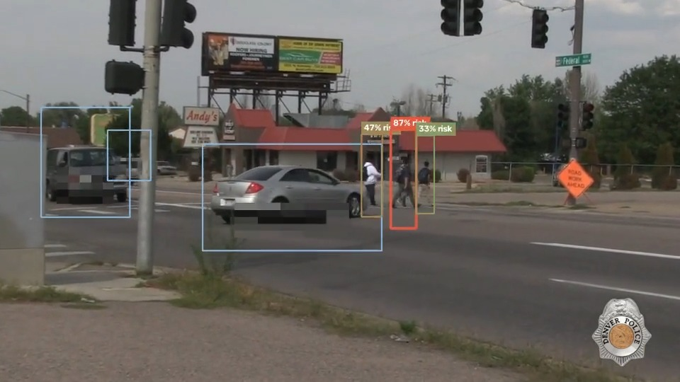

# CROSSING

**Pedestrian safety intelligence. It turns ordinary street video into a live read on who is
about to be hit.**



A street is not a pile of objects. It is a constantly changing set of interactions between
people and vehicles. CROSSING models that. Object detection is just the sensor. On top of it
the system tracks every person and every vehicle, recovers how far apart they really are in
the world, and estimates for each pedestrian a probability of being hit.

Live demo: **https://crossing-pi.vercel.app**

```
video  ->  detect (YOLOv3)  ->  track (Kalman + ByteTrack, persistent IDs)
       ->  world model (image to ground metres; velocity, heading, motion)
       ->  depth-aware risk (probability of being hit, green to red)
       ->  near-miss detection, explanation, counterfactuals
       ->  event graph, city hotspots, operational read
```

Observe, understand, predict, act.

## What the demo shows

Six real close-call clips from very different places (a mid-block crossing, a dusk city
street, a downtown crosswalk, a busy corner, a signalised crossing, a crowded marked
crosswalk). Every clip runs through the real pipeline. Each pedestrian box is painted by its
probability of being hit, from green (safe) to red (danger), and a subtitle calls out the
close calls as they happen. Faces and licence plates are blurred inside the pipeline before
any frame is shown.

The site has three tabs. **Live** is the six videos. **Explanation** describes the product in
plain language. **Results** is the measured model performance.

Run it locally with the full API:

```bash
pip install -r requirements.txt
python -m uvicorn crossing.api.server:app --port 8000   # open http://localhost:8000
```

`/` is the safety page. `/api/metrics` serves the measured numbers. The governed endpoints
below (`/api/fleet`, `/api/lineage`, `/api/monitoring`, `/api/audit`, `/api/whoami`) are also
served locally.

## The core idea

Judging danger from where boxes sit in the 2D image is wrong. A car can overlap a pedestrian
on screen and still be far behind or ahead of them in depth. So CROSSING recovers an
approximate metric position for every actor from its box (height gives depth, horizontal
offset gives lateral position) and measures the real distance between them. A car that only
looks close scores near zero.

Two more conditions gate the score, so it fires only on genuine danger:

1. The vehicle has to be **actually moving**. A parked or stopped car never raises risk,
   however close it is. Motion is confirmed from real displacement over recent frames, which
   ignores the box jitter a stationary car shows, not from a single noisy velocity reading.
2. The vehicle has to be **headed toward the person**. A car moving away or across is not a
   threat. Risk then ramps up with how fast the gap is closing.

## What it does (measured on held-out test scenes)

| Capability | Metric | Result |
|---|---|---|
| Near-miss risk prediction | AUROC (learned) vs TTC and motion baseline | **0.951** vs 0.868 |
| Risk calibration | Expected Calibration Error (learned vs physics) | **0.002** vs 0.368 |
| Crossing intention | AUROC and mean early warning before road entry | **0.961** and **2.8 s** |
| Detection | precision / recall / F1 | 0.999 / 0.909 / 0.952 |
| Tracking | MOTA / IDF1 | 0.745 / 0.702 |
| Trajectory | minADE / minFDE | 0.83 m / 1.27 m |

The headline result is that a learned interaction model beats an engineered TTC-based score
at predicting near-misses before they happen, and it is calibrated, so a risk of 80 really
does mean that about 80 out of 100 such situations become a near-miss. Every number is
produced by `python -m scripts.train_all` and written to `artifacts/metrics/`. Nothing is
hand-entered.

## How it works

**Data.** Developing and evaluating a stack like this needs ground truth, so
`crossing.data.simulator` generates signalised-intersection scenes with car-following,
permissive turns, a signal controller, gap-acceptance pedestrians with evolving crossing
intention, and seeded conflict scenarios that reliably produce genuine near-misses. It
renders each actor to an image-space detection through the scene geometry with calibrated
noise, misses, false positives, and occlusion, then keeps the ground truth for scoring.
Splits are by scene, so no pedestrian appears in both train and test. Real PIE and JAAD
footage plugs into the same schema through `crossing.data.pie_adapter`.

**Perception, tracking, world model.** YOLOv3 detection feeds a ByteTrack-style tracker
(two-stage association, Kalman motion, a lost-track buffer for occlusion). A homography lifts
each ground-contact point onto the road plane, where a Kalman filter yields stable position,
velocity, heading, and acceleration in metres.

**Behaviour, prediction, interaction, risk.** Crossing intention comes from a from-scratch
NumPy GRU (back-prop through time, gradient checked) that emits a calibrated probability
evolving over time rather than a yes or no. Prediction produces several goal-conditioned
futures per actor. Interaction is closed-form conflict geometry (TTC, DCPA, TCPA, PET, path
conflict), unit-tested against hand-computed cases. Risk fuses these into a calibrated score
that is also its own explanation, since each factor contributes a known share.

**Event graph and city intelligence.** Each scene becomes a knowledge graph of actors,
events, and zones. Across many scenes a city analyzer builds a spatial risk map and ranked
hotspots. Everything persists to a SQLite event database you can query in plain SQL.

## Governance (production posture)

A model watching public streets has to be operable and accountable, not just accurate. These
layers run in the backend and API.

* **Provenance** (`crossing/provenance/`). Every risk score is tied to the content-addressed
  version of the model that made it and carries its full lineage: which detections, over how
  many frames, at what confidence, tracked into which actor, closing with which vehicle,
  through which components. Where a score came from always has an answer.
* **Privacy** (`crossing/privacy/`). Faces and plates are mosaic-redacted inside the pipeline
  before any frame is written or served, so raw imagery never leaves the processing step.
* **Access control and audit** (`crossing/security/`). The API is role-gated across viewer,
  operator, analyst, and admin. The raw feed, the lineage, and the audit log each need a
  higher scope, and every governed read is written to an append-only audit log.
* **Scale and monitoring** (`crossing/streaming/`, `crossing/monitoring/`). A fleet registry
  models many camera feeds with health and backpressure, and drift (population stability plus
  KS) with calibration tracking watches whether the live input still matches what the model
  was built for.

## Layout

```
crossing/
  schema.py            unified data model (entities, interactions, events, recordings)
  config.py            coordinate conventions, physical constants, risk thresholds
  data/                simulator, PIE/JAAD adapter, SQLite event DB
  perception/          detector (YOLO or replay), pose cues
  tracking/            Kalman filters, ByteTrack, assisted tracker
  worldmodel/          homography, motion (kinematics), state assembly
  behavior/            behavioural features, crossing intention (heuristic and GRU)
  prediction/          multi-modal trajectory prediction
  interaction/         conflict-geometry metrics, interaction engine
  risk/                risk engine, near-miss detection, explanation, counterfactuals
  ml/                  numpy NN (GRU and Adam), datasets, baselines, training, evaluation
  graph/               event graph, city analyzer
  provenance/          content-addressed model version, risk lineage
  privacy/             in-pipeline face and plate redaction
  security/            role-based access control, append-only audit log
  streaming/           camera-fleet registry, bounded ingestion queue
  monitoring/          PSI and KS drift, calibration tracking
  pipeline.py          end-to-end orchestrator
  api/                 FastAPI page and JSON API
frontend/index.html    the live safety page (Live, Explanation, Results)
scripts/               safety_video, build_gallery, scan_closecalls, train_all
tests/                 geometry, homography, Kalman, GRU grad-check, motion gate, governance
```

## Honesty

* Splits are by scene, so no pedestrian appears in both train and test.
* The risk score is calibrated (reliability diagram and ECE), not asserted.
* The measured table above comes from the learned model trained and evaluated on the
  simulator with ground truth. The risk shown on the real demo videos is the depth-aware
  geometric scorer, since the real footage has no labelled outcomes to score against.
* Counterfactuals are model simulations over recorded trajectories, not proof that any single
  intervention would have changed the outcome.

MIT licensed.
